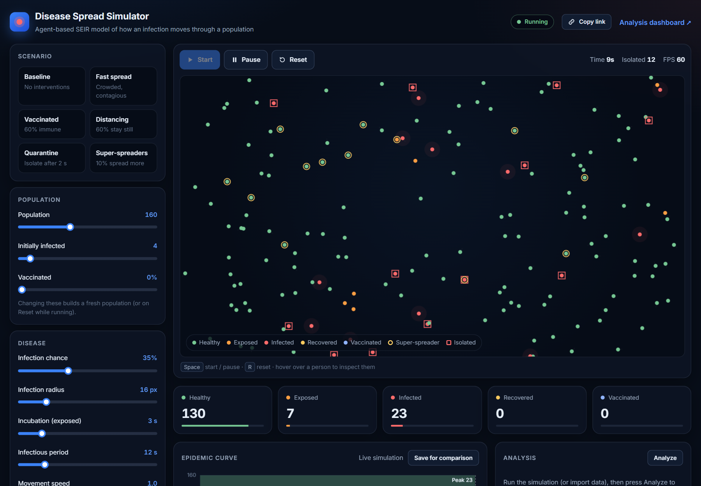
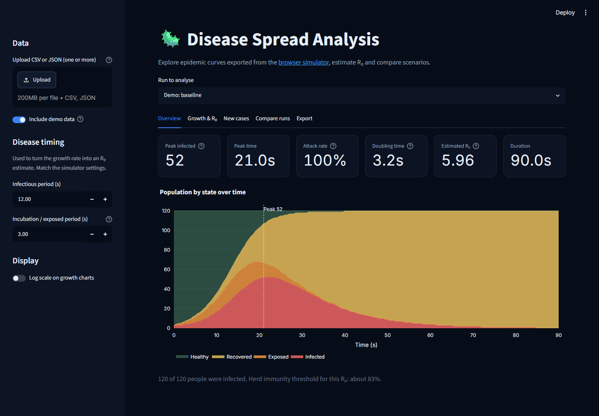
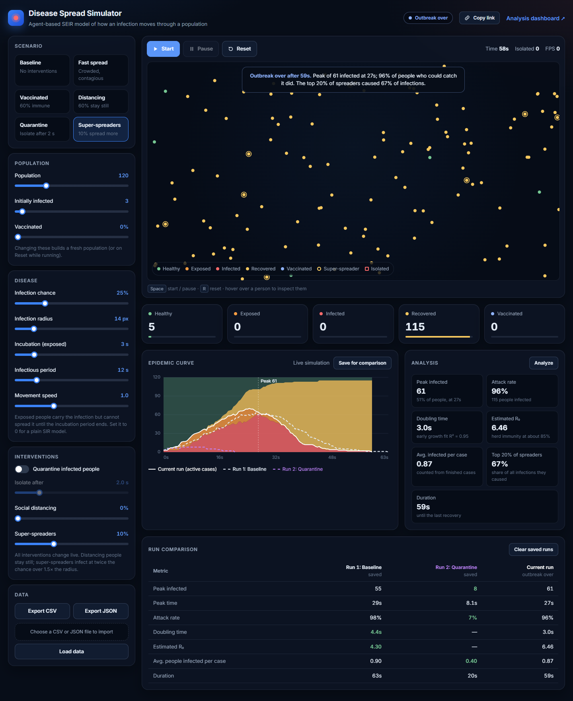

# 🦠 Disease Spread Simulator & Analysis Dashboard

Agent-based SEIR disease spread simulator with interventions, run comparison, shareable scenarios, in-browser epidemic analysis and an interactive data science dashboard. It showcases **agent-based modeling**, **real-time visualization**, and **data science** skills.

---

## 🔗 Live Demo

**Simulator:** https://sameeha0.github.io/Disease-Spread-Animation-Web-Game/

**Analysis Dashboard:** [Streamlit Cloud](https://disease-spread-animation-web-game-tccqs9bdlxcy6uykdsx4mh.streamlit.app/)



## Key Features

### Simulator (index.html)
- **SEIR Model**: every person is healthy, exposed (infected but not yet infectious), infected, recovered or vaccinated; set the incubation period to 0 for a plain SIR model
- **Interventions** (all change live):
  - **Quarantine**: infected people are isolated after a chosen delay; isolated people stop moving and cannot infect anyone
  - **Social distancing**: a chosen share of people stay still
  - **Super-spreaders**: a chosen share of people infect at twice the chance over 1.5x the radius
- **Compare Runs**: save up to 3 runs; they stay on the chart as dashed lines and appear in a side-by-side comparison table with the best value highlighted
- **Shareable Links**: every setting is kept in the page address; "Copy link" gives a URL that opens the exact same scenario
- **6 Preset Scenarios**: Baseline, Fast Spread, Vaccinated, Distancing, Quarantine, Super-spreaders (each preset sets every parameter, so scenarios never mix)
- **Real-Time Visualization**: high-DPI canvas at 60 FPS with movement trails, infection zones, gold rings for super-spreaders and squares for isolated people
- **Hover to Inspect**: state, time until infectious / recovered, who infected them, how many people they infected
- **Stacked Epidemic Curve**: all five states over time, with the peak marked
- **In-Browser Analysis** (no backend needed): peak, attack rate, doubling time (log-linear fit with R²), estimated R₀ and herd-immunity threshold, average people infected per case, and the share of infections caused by the top 20% of spreaders
- **Outbreak Summary**: the simulation stops by itself when the last case recovers and shows a summary
- **Spatial Optimization**: grid-based neighbor lookup for O(1) contact checks
- **Data Import/Export**: CSV/JSON (SEIR and older SIR files both load)
- **Keyboard Shortcuts**: <kbd>Space</kbd> start / pause, <kbd>R</kbd> reset
- **Responsive Design**: desktop, tablet and phone

### Analysis Dashboard (streamlit_app.py)
- **Matches the simulator**: same dark theme, colours and metric definitions
- **Upload one or more files**: CSV/JSON exported from the simulator (SEIR or SIR)
- **Overview**: properly stacked population chart with the peak marked, plus key metrics
- **Growth & R₀**: exponential fit of early growth (log scale option), doubling time, R₀ estimate from the infectious and incubation periods, and a logistic fit of cumulative infections
- **New Cases**: new infections and recoveries per sample
- **Compare Runs**: overlay active cases from several files and compare their metrics in a table
- **Export**: data and summary as CSV/JSON
- **Demo Data**: two deterministic SEIR runs (baseline and distancing) for trying the dashboard





---

## How the model works

1. **Movement**: every person moves in a random walk and bounces off the walls; distancing and isolated people stay still.
2. **Contact**: for each infectious person, the spatial grid returns nearby people; anyone healthy inside the infection radius can be infected.
3. **Transmission**: the chance falls linearly with distance. It is converted to the length of each frame, so the spread is the same at any frame rate and on any screen.
4. **Disease stages**: a newly infected person is exposed for the incubation period, then infectious for the infectious period, then recovered and immune.
5. **Analysis**: R₀ is estimated with the SEIR approximation R₀ ≈ (1 + r·D)(1 + r·L), where r is the early exponential growth rate, D the infectious period and L the incubation period (with L = 0 this is the SIR formula 1 + r·D).

---

## Data Format

**CSV:**
```csv
t,healthy,exposed,infected,recovered,vaccinated
0,117,0,3,0,0
0.5,116,1,3,0,0
1,114,3,3,0,0
```

**JSON:**
```json
[
  {"t":0,"healthy":117,"exposed":0,"infected":3,"recovered":0,"vaccinated":0},
  {"t":0.5,"healthy":116,"exposed":1,"infected":3,"recovered":0,"vaccinated":0}
]
```

`exposed` and `vaccinated` are optional, so older SIR files still work.

---

## Local Development (Optional)

**View simulator locally:**
```bash
python -m http.server 8000
# then open http://localhost:8000
```

**Run analysis dashboard locally:**
```bash
pip install -r requirements.txt
streamlit run streamlit_app.py
```

Opens the interactive dashboard at `http://localhost:8501`

---

## Testing Checklist

- [x] **Simulator**: agents appear on load; Start / Space begins the run
- [x] **SEIR**: exposed people appear and become infectious after the incubation period
- [x] **Interventions**: quarantine isolates infected people (baseline 98% attack rate vs 7% with quarantine in testing); distancing people stay still; super-spreaders are marked
- [x] **Compare runs**: saved runs draw as dashed lines and fill the comparison table
- [x] **Shareable links**: opening a copied link restores every slider and the quarantine switch
- [x] **Outbreak end**: simulation stops and shows a summary when no one is exposed or infected
- [x] **Analysis**: peak, attack rate, doubling time, R₀ and spreading statistics calculate in the browser
- [x] **Data Import**: CSV/JSON files parse and draw on the chart
- [x] **Responsive**: no horizontal scrolling at 390 px wide
- [x] **Dashboard**: runs without errors on every tab with demo data (checked with Streamlit's AppTest)

---

## Project Structure

```
├── index.html          # Simulator UI
├── js/
│   └── simulation.js   # Agent-based engine, chart, analysis and UI logic
├── css/
│   └── style.css       # Design tokens, responsive layout
├── docs/               # README screenshots
├── streamlit_app.py    # Interactive analysis dashboard
├── .streamlit/
│   └── config.toml     # Dashboard theme (matches the simulator)
├── requirements.txt    # Python dependencies
└── README.md
```

---

## Highlights

**Frontend Skills**
- Canvas API with high-DPI scaling for real-time 60 FPS visualization
- Vanilla JavaScript (no frameworks), OOP design with Agent and Simulation classes
- Design system with CSS custom properties; accessible controls, keyboard shortcuts and reduced-motion support

**Data Science Skills**
- Epidemic metrics computed in the browser: log-linear growth fit, doubling time, SEIR R₀ estimate, spreading inequality (top 20% share)
- Deterministic SEIR model (SciPy solve_ivp) for the dashboard's demo data
- Python scientific computing (SciPy, NumPy, pandas) and interactive Streamlit dashboards

**Engineering Skills**
- Spatial optimization: O(1) neighbor lookup with grid indexing
- Frame-rate-independent transmission model
- Scenario state encoded in the URL for shareable links
- Data processing: CSV/JSON parsing and export

**Deployment**
- Simulator on GitHub Pages (deploys from the `main` branch)
- Dashboard on Streamlit Cloud

---
## 📜 License
Copyright © 2026 Sameeha. All rights reserved.

This project is proprietary software. Unauthorized copying, modification, distribution, or use of this code, in whole or in part, for any purpose (commercial or non-commercial) is strictly prohibited without the prior written permission of the author.

For permission requests, please contact: sameeharaza07@gmail.com
